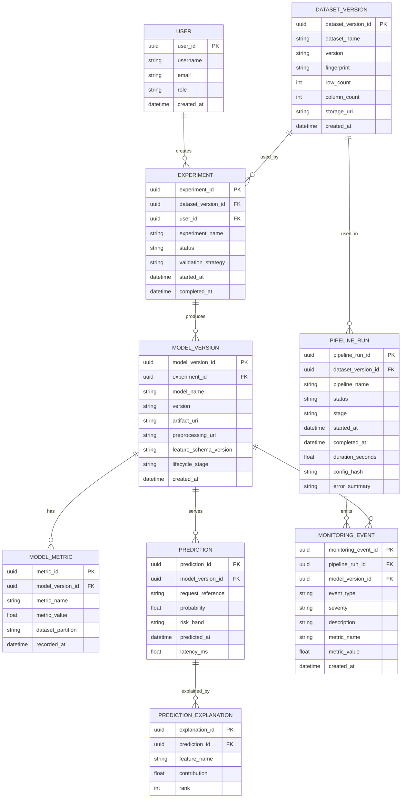

# Sentinel Health — Entity Relationship Design

## 1. Purpose
This ERD is a logical future schema for dataset versions, pipeline executions, experiments, models, metrics, predictions, explanations, and monitoring events. The current prototype uses only a local SQLite prediction-event table and a JSON model registry; it does not implement all entities below. It intentionally avoids storing full raw clinical records.

## 2. ER Diagram

## 3. Entity Definitions
### USER
Optional application identity and role. In a local portfolio version, authentication can be deferred.

### DATASET_VERSION
Represents a dataset snapshot or fingerprint. Track source, version, row/column counts, and storage reference.

### PIPELINE_RUN
One execution of ingestion, validation, preprocessing, training, or monitoring. It stores status, timing, configuration fingerprint, and failure summary.

### EXPERIMENT
A controlled ML experiment tied to a dataset version and validation strategy.

### MODEL_VERSION
A trained model artifact plus its preprocessing artifact and feature-schema version. Keep these linked so inference uses compatible artifacts.

### MODEL_METRIC
Stores metrics for a named partition (train, CV, validation, test). Test metrics should be clearly identified and not used repeatedly for model selection.

### PREDICTION
Stores prediction metadata, model version, probability, risk band if configured, latency, and a non-identifying request reference.

### PREDICTION_EXPLANATION
Stores ranked feature contributions for a prediction. Avoid storing raw patient values unless required and approved.

### MONITORING_EVENT
Stores quality, drift, pipeline, or service events. Metric name/value can be null for event-only alerts.

## 4. Integrity Rules
- Dataset fingerprint and version should be unique.
- Model versions are unique within model lineage.
- Model metric names and partition names are constrained.
- Predictions must reference an existing model version.
- Explanations must reference a prediction.
- Pipeline runs must reference the dataset version they processed.
- Model and preprocessing artifacts must share a feature-schema version.
- Do not store direct identifiers in prediction records.
- Retention and deletion policy should be documented.

## 5. Suggested SQLAlchemy Model Modules
- `DatasetVersion`
- `PipelineRun`
- `Experiment`
- `ModelVersion`
- `ModelMetric`
- `Prediction`
- `PredictionExplanation`
- `MonitoringEvent`
- Optional `User`
