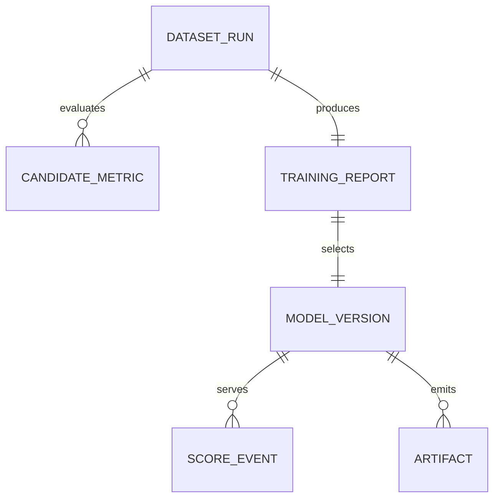

# Sentinel Health CKD Entity Relationships

The application stores model/run metadata and aggregate score telemetry. It does not store patient-level prediction inputs. The included source dataset is read locally and model artifacts remain under `artifacts/ckd/`.
